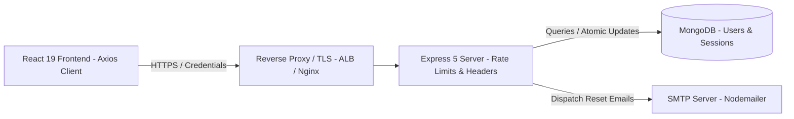
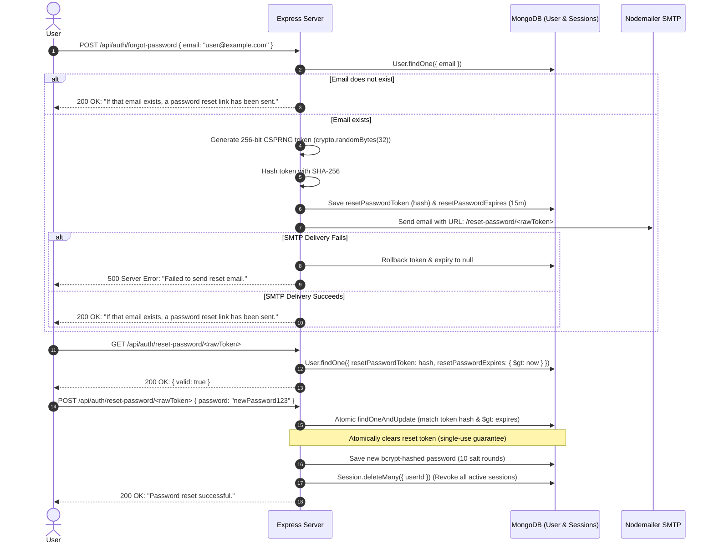

# Production-Grade Authentication & Authorization System

A robust, full-stack authentication microservice and client built with **Node.js**, **Express 5**, **MongoDB (Mongoose 9)**, **React 19**, **Vite 7**, and **Tailwind CSS v4**.

Designed with defense-in-depth security principles: concurrency-safe refresh token rotation, multi-device session management, single-use cryptographically secure password resets, server-side role-based access control (RBAC), endpoint-specific rate limiting, and 100% hermetic unit test coverage.

---

## Table of Contents

- [Architecture Overview](#architecture-overview)
- [Authentication & Token Lifecycle](#authentication--token-lifecycle)
  - [Dual-Token Strategy](#dual-token-strategy)
  - [Concurrency-Safe Rotation & Grace Period](#concurrency-safe-rotation--grace-period)
  - [Session Revocation Scope](#session-revocation-scope)
- [Password-Reset Flow](#password-reset-flow)
- [Role-Based Access Control (RBAC)](#role-based-access-control-rbac)
- [Rate Limiting & Account Lockout](#rate-limiting--account-lockout)
- [CORS, Cookies & Deployment Topology](#cors-cookies--deployment-topology)
- [Environment Configuration](#environment-configuration)
- [Database Schema & Indexes](#database-schema--indexes)
- [API Reference](#api-reference)
  - [Health Check](#health-check)
  - [Authentication Endpoints](#authentication-endpoints)
  - [User Profile Endpoints](#user-profile-endpoints)
  - [Administrative Endpoints](#administrative-endpoints)
- [Developer Commands & CI](#developer-commands--ci)
  - [Initial Setup](#initial-setup)
  - [Development & Production Builds](#development--production-builds)
  - [Linting & Testing](#linting--testing)
  - [GitHub Actions CI](#github-actions-ci)
- [Known Limitations & Operational Considerations](#known-limitations--operational-considerations)

---

## Architecture Overview

The system is organized as a monorepo containing a standalone backend API and a single-page React frontend application:

```
auth-system-backend/
├── .github/
│   └── workflows/
│       └── ci.yml             # GitHub Actions CI (Backend & Frontend)
├── client/                    # React 19 + Vite 7 Frontend SPA
│   ├── src/
│   │   ├── components/        # Protected & Admin route guards, layout
│   │   ├── context/           # AuthContext provider with refresh handling
│   │   ├── pages/             # Login, Signup, Dashboard, Profile, Admin, Reset
│   │   └── services/          # Axios instance with single-flight request queue
│   ├── test/                  # Interceptor & queue unit tests
│   ├── .env.example           # Client environment template
│   └── package.json           # Client scripts (dev, build, lint, test)
├── server/                    # Express 5 REST API Backend
│   ├── config/                # Environment validation & configuration
│   ├── controllers/           # Auth, User, and Admin business logic
│   ├── middleware/            # Auth, RBAC, rate-limiting, and validation
│   ├── models/                # User and Session Mongoose schemas
│   ├── routes/                # Express API route declarations
│   ├── test/                  # 8 hermetic test suites (100 unit tests)
│   ├── utils/                 # Token hashing, cookie options, email dispatch
│   ├── .env.example           # Server environment template
│   ├── app.js                 # Express application middleware assembly
│   ├── server.js              # HTTP server listener and DB connection
│   └── package.json           # Server dependencies and test scripts
└── README.md
```

### High-Level Request & Security Architecture



---

## Authentication & Token Lifecycle

### Dual-Token Strategy

Authentication employs a dual-token JWT architecture with strict algorithm pinning (`HS256`):

| Token Type | Lifespan | Signature Secret | Client Storage | Transmission Mode | Payload Contents |
| :--- | :--- | :--- | :--- | :--- | :--- |
| **Access Token** | Configurable (default `15m`, bounded `1m`–`1h`) | `JWT_ACCESS_SECRET` | Memory / `localStorage` | `Authorization: Bearer <token>` | `{ userId, type: "access" }` |
| **Refresh Token** | Configurable (default `7d`, bounded `1h`–`30d`) | `JWT_REFRESH_SECRET` | `httpOnly`, `SameSite` cookie | Cookie: `refreshToken` (path: `/api/auth`) | `{ userId, sessionId, type: "refresh" }` |

- **Substitution Prevention:** Tokens contain an explicit `type` claim (`access` vs `refresh`). Supplying a refresh token to authentication middleware or an access token to the `/refresh` endpoint is immediately rejected.
- **Server-Side Identity:** User roles and identity are derived from database queries during request execution, never trusted from client-controlled claims.

### Concurrency-Safe Rotation & Grace Period

To protect against stolen credentials, refresh tokens are rotated on every refresh. To prevent race conditions from concurrent browser requests, the system implements a **20-second grace period**:

```mermaid
sequenceDiagram
    autonumber
    actor User as User / Browser
    participant Axios as Frontend Axios Queue
    participant Server as Express Server
    participant DB as MongoDB (Session)

    Note over User,Axios: Multiple parallel requests trigger 401 Unauthorized
    Axios->>Server: POST /api/auth/refresh (Cookie: refreshToken_A)
    Note over Axios: Concurrent requests queued (single-flight)
    Server->>DB: Atomic findOneAndUpdate (currentHash == hash(A))
    DB-->>Server: Matched & Updated: currentHash=hash(B), previousHash=hash(A)
    Server-->>Axios: 200 OK + new AccessToken_B + Cookie: refreshToken_B
    Note over Axios: Drains queue; pending requests retried with AccessToken_B

    opt Racing parallel refresh within 20-second window
        Axios->>Server: POST /api/auth/refresh (Cookie: refreshToken_A)
        Server->>DB: Check Session (previousHash == hash(A) && age < 20s)
        DB-->>Server: Within grace period
        Server-->>Axios: 200 OK (re-issues AccessToken_B without re-rotating)
    end

    opt Replay attack detected after grace period (> 20s)
        actor Attacker
        Attacker->>Server: POST /api/auth/refresh (stolen refreshToken_A)
        Server->>DB: Check Session (hash(A) is expired previousHash)
        Server->>DB: Session.deleteOne (Revoke entire session)
        Server-->>Attacker: 401 Unauthorized (Session terminated)
    end
```

1. **Hashed Persistence:** The server **never** stores plaintext refresh tokens. Only SHA-256 hashes (`currentHash`, `previousHash`) are persisted in the `sessions` collection.
2. **Atomic Transition:** Rotation uses MongoDB atomic conditional operations (`Session.findOneAndUpdate`), preventing race-condition double-spend.
3. **Replay Detection:** If a previously consumed refresh token is presented after the 20-second grace window, the server detects potential token theft and revokes the entire session immediately.
4. **Frontend Single-Flight Queue:** Axios response interceptors ensure that when multiple concurrent requests receive HTTP 401, only **one** refresh request is dispatched; subsequent requests are queued and resolved with the new token.

### Session Revocation Scope

- **Single-Device Logout (`POST /api/auth/logout`):** Deletes the specific `Session` document matching the current refresh token hash or `sessionId` and clears the cookie. Other active devices remain authenticated.
- **Global Logout (`POST /api/auth/logout-all`):** Deletes all `Session` records for the user across all devices.
- **Password Reset Revocation:** Successfully resetting a password automatically revokes all active sessions across all devices.

---

## Password-Reset Flow

The password reset flow implements strict anti-enumeration and single-use cryptographic controls:



- **Anti-Account Enumeration:** The server returns identical HTTP 200 responses and includes timing mitigation whether the email address exists or not.
- **No Plaintext Token Storage:** Only the SHA-256 hash of the reset token is stored in the database. Raw tokens are never returned in API payloads or logged.
- **Atomic Single-Use Semantics:** `User.findOneAndUpdate` atomically invalidates the token upon use, ensuring simultaneous concurrent requests cannot reuse the credential.
- **Automatic Delivery Rollback:** If the SMTP provider fails, the stored token hash is cleared to prevent orphaned active tokens.

---

## Role-Based Access Control (RBAC)

Authorization is enforced server-side via layered middleware:

1. **Authentication Guard (`auth.middleware.js`):** Validates the access token signature, expiration, and token type claim. Fetches the current user record from MongoDB to verify existence.
2. **Role Guard (`role.middleware.js`):** Inspects the verified database user record:
   - Normal users have `role: "user"`.
   - Administrators have `role: "admin"`.
   - Unauthorized access to `/api/admin/*` returns HTTP 403 Forbidden.
3. **Privilege Escalation Defenses:**
   - Client-supplied `role` fields during registration (`POST /api/auth/signup`) and profile updates (`PUT /api/user/profile`) are ignored.
   - Roles can only be updated by authenticated administrators via `PUT /api/admin/users/:id/role`.
4. **Administrative Self-Action Guards:**
   - Administrators cannot delete their own account (`DELETE /api/admin/users/:id`).
   - Administrators cannot demote themselves to ordinary users (`PUT /api/admin/users/:id/role`).

---

## Rate Limiting & Account Lockout

### Endpoint-Specific Rate Limiters

Rate limiting is applied using `express-rate-limit` with custom, sanitized JSON responses:

| Endpoint | Limiter | Window | Max Requests | Policy Details |
| :--- | :--- | :--- | :--- | :--- |
| `POST /api/auth/login` | `loginLimiter` | 15 minutes | 5 attempts | `skipSuccessfulRequests: true` (only counts failed logins per IP) |
| `POST /api/auth/signup` | `signupLimiter` | 1 hour | 5 registrations | Mitigates mass bot registrations per IP |
| `POST /api/auth/forgot-password` | `forgotPasswordLimiter` | 1 hour | 3 requests | Prevents SMTP flooding and inbox spam |
| `* /api/auth/reset-password/*` | `resetPasswordLimiter` | 15 minutes | 5 requests | Throttles reset token probing and submissions |
| `POST /api/auth/refresh` | `refreshLimiter` | 15 minutes | 30 requests | Throttles excessive token refresh cycles |
| `/api/*` | `generalLimiter` | 15 minutes | 100 requests | General API denial-of-service guard |

### Account Lockout

- **Lockout Threshold:** 5 consecutive failed login attempts on a single account.
- **Lockout Duration:** Configurable via `ACCOUNT_LOCKOUT_MINUTES` (default: 15 minutes, clamped between 1 and 120 minutes).
- **Behavior:** Returns HTTP 423 Locked with the remaining time in minutes.
- **Anti-Bypass Email Normalization:** Email addresses are normalized (`trim().toLowerCase()`) before querying, preventing lockout evasion via casing variations (`User@Example.com` vs `user@example.com`).

---

## CORS, Cookies & Deployment Topology

### CORS Configuration

CORS is configured in [`server/app.js`](file:///c:/Users/Arnav/Desktop/projects/auth-system-backend/server/app.js) with explicit origin validation:

- **Credentials:** `credentials: true` enables secure cookie transmission.
- **Trusted Origins:** Derived from `FRONTEND_URL` (comma-separated origins supported).
- **Wildcards Disabled:** Wildcard origins (`*`) are disallowed when credentials are enabled.
- **Methods & Headers:** Allowed methods restricted to `GET, POST, PUT, DELETE, OPTIONS`. Allowed headers restricted to `Content-Type, Authorization`.
- **Preflight Caching:** Preflight `OPTIONS` responses cached for 24 hours (`maxAge: 86400`).

### Cookie Security Matrix

Refresh token cookies are configured via [`server/utils/cookie.js`](file:///c:/Users/Arnav/Desktop/projects/auth-system-backend/server/utils/cookie.js):

| Attribute | Setting | Description |
| :--- | :--- | :--- |
| `httpOnly` | `true` | Prevents access via client JavaScript (`document.cookie`), mitigating XSS. |
| `path` | `/api/auth` | Scoped strictly to authentication endpoints. |
| `sameSite` | `lax` \| `strict` \| `none` | Default `lax`. Set to `none` if frontend and backend reside on different domains (e.g. Vercel + Render). |
| `secure` | `true` in production | Automatically forced if `NODE_ENV=production` or `SameSite=none`. Requires HTTPS. |
| `domain` | Optional | Set via `COOKIE_DOMAIN` for subdomain sharing (e.g., `.yourdomain.com`). |

### Reverse Proxy Configuration

When hosting behind reverse proxies or load balancers (AWS ALB, Cloudflare, Nginx, Render), set `TRUST_PROXY=true` to ensure correct IP resolution for rate limiting and cookie handling.

---

## Environment Configuration

### Backend Variables ([`server/.env.example`](file:///c:/Users/Arnav/Desktop/projects/auth-system-backend/server/.env.example))

The server validates all environment variables on startup via [`server/config/env.js`](file:///c:/Users/Arnav/Desktop/projects/auth-system-backend/server/config/env.js). If any required setting is missing or insecure, the server exits with a descriptive error.

| Variable | Required | Default | Safe Bounds / Format | Purpose |
| :--- | :---: | :---: | :--- | :--- |
| `PORT` | No | `5000` | Integer 1–65535 | HTTP server port |
| `NODE_ENV` | No | `development` | `development`, `production`, `test` | Runtime environment mode |
| `MONGO_URI` | Yes | - | MongoDB connection URI | MongoDB connection string (Atlas or local) |
| `JWT_ACCESS_SECRET` | Yes | - | $\ge 32$ chars in production | Secret key used to sign access tokens |
| `JWT_REFRESH_SECRET` | Yes | - | $\ge 32$ chars in production | Secret key used to sign refresh tokens (must differ from access secret) |
| `JWT_ACCESS_EXPIRES_IN` | No | `15m` | `1m` to `1h` (e.g., `15m`, `30m`) | Access token lifespan |
| `JWT_REFRESH_EXPIRES_IN`| No | `7d` | `1h` to `30d` (e.g., `7d`, `14d`) | Refresh token lifespan |
| `JWT_ISSUER` | No | - | String | Optional JWT issuer claim verification |
| `JWT_AUDIENCE` | No | - | String | Optional JWT audience claim verification |
| `FRONTEND_URL` | No | `http://localhost:5173` | Comma-separated URLs | Allowed CORS frontend origins |
| `COOKIE_SAME_SITE` | No | `lax` | `lax`, `strict`, `none` | SameSite cookie attribute |
| `COOKIE_SECURE` | No | `false` | `true`, `false` | Forces Secure cookie flag |
| `COOKIE_DOMAIN` | No | - | Domain string | Optional cookie domain scope |
| `RESET_TOKEN_EXPIRE_MINUTES` | No | `15` | Positive integer | Expiration for password reset tokens |
| `ACCOUNT_LOCKOUT_MINUTES` | No | `15` | 1–120 minutes | Lockout duration after 5 failed logins |
| `TRUST_PROXY` | No | `false` | `true`, `false` | Trust reverse proxy headers (`X-Forwarded-For`) |
| `EMAIL_HOST` | Yes* | - | SMTP host | SMTP server address for reset emails |
| `EMAIL_PORT` | Yes* | `587` | Port number | SMTP server port |
| `EMAIL_USER` | Yes* | - | Email address | SMTP authentication username |
| `EMAIL_PASSWORD` | Yes* | - | App password | SMTP authentication password |
| `EMAIL_FROM` | No | `noreply@example.com` | Email address | Sender address for system emails |
| `APP_NAME` | No | `AuthSystem` | String | Application display name in emails |

*\* Required when initiating the password reset flow in development or production.*

### Frontend Variables ([`client/.env.example`](file:///c:/Users/Arnav/Desktop/projects/auth-system-backend/client/.env.example))

| Variable | Required | Default | Description |
| :--- | :---: | :---: | :--- |
| `VITE_API_URL` | No | `http://localhost:5000/api` | Base URL of the backend API |

---

## Database Schema & Indexes

The database uses MongoDB with Mongoose schemas and strict indexing:

### 1. `User` Schema (`users` collection)
- `email`: String (lowercase, trimmed, required, unique index).
- `password`: String (bcrypt hashed with 10 salt rounds, excluded from default queries).
- `role`: Enum `["user", "admin"]` (default `"user"`).
- `loginAttempts`: Number (default `0`).
- `lockUntil`: Date (default `null`).
- `resetPasswordToken`: String (SHA-256 hash, sparse index).
- `resetPasswordExpires`: Date (timestamp).
- `isLocked`: Virtual property (`lockUntil > Date.now()`).

### 2. `Session` Schema (`sessions` collection)
- `userId`: ObjectId (references `User`, indexed).
- `currentHash`: String (SHA-256 hash of active refresh token, unique index).
- `previousHash`: String (SHA-256 hash of rotated refresh token for grace period, sparse index).
- `rotatedAt`: Date (timestamp of last rotation).
- `expiresAt`: Date (TTL index: MongoDB automatically removes expired sessions).
- `userAgent`: String (client user agent).
- `ipAddress`: String (client IP).

---

## API Reference

All requests and responses use JSON. Authenticated endpoints expect:
`Authorization: Bearer <accessToken>`

### Health Check

#### `GET /health`
Returns system status. Bypasses rate limits.

**Response (200 OK):**
```json
{
  "status": "OK",
  "timestamp": "2026-10-29T10:00:00.000Z"
}
```

---

### Authentication Endpoints

#### `POST /api/auth/signup`
Creates a new user account. Client-supplied `role` is ignored.

**Request:**
```json
{
  "email": "user@example.com",
  "password": "SecurePassword123"
}
```

**Response (201 Created):**
```json
{
  "message": "User created successfully",
  "user": {
    "id": "6720f123456789abcdef0001",
    "email": "user@example.com",
    "role": "user"
  }
}
```

---

#### `POST /api/auth/login`
Authenticates user, establishes a hashed session, sets an `httpOnly` refresh cookie, and returns an access token.

**Request:**
```json
{
  "email": "user@example.com",
  "password": "SecurePassword123"
}
```

**Response (200 OK):**
*Set-Cookie: refreshToken=\<token\>; Path=/api/auth; HttpOnly; SameSite=Lax*
```json
{
  "message": "Login successful",
  "accessToken": "eyJhbGciOiJIUzI1NiIsInR5cCI6IkpXVCJ9...",
  "user": {
    "id": "6720f123456789abcdef0001",
    "email": "user@example.com",
    "role": "user"
  }
}
```

---

#### `POST /api/auth/refresh`
Rotates the refresh token and returns a new access token. Reads the refresh token from the `httpOnly` cookie.

**Response (200 OK):**
*Set-Cookie: refreshToken=\<newRotatedToken\>; Path=/api/auth; HttpOnly; SameSite=Lax*
```json
{
  "accessToken": "eyJhbGciOiJIUzI1NiIsInR5cCI6IkpXVCJ9...",
  "user": {
    "id": "6720f123456789abcdef0001",
    "email": "user@example.com",
    "role": "user"
  }
}
```

---

#### `POST /api/auth/logout`
Revokes the calling device's session and clears the cookie.

**Response (200 OK):**
*Set-Cookie: refreshToken=; Path=/api/auth; Expires=Thu, 01 Jan 1970 00:00:00 GMT*
```json
{
  "message": "Logged out successfully"
}
```

---

#### `POST /api/auth/logout-all`
Revokes all active sessions across all devices for the authenticated user.
*Requires `Authorization: Bearer <accessToken>`*

**Response (200 OK):**
```json
{
  "message": "All sessions logged out successfully"
}
```

---

#### `POST /api/auth/forgot-password`
Initiates the password reset flow. Returns a generic response to prevent account enumeration.

**Request:**
```json
{
  "email": "user@example.com"
}
```

**Response (200 OK):**
```json
{
  "message": "If that email exists, a password reset link has been sent."
}
```

---

#### `GET /api/auth/reset-password/:token`
Verifies whether a reset token is valid and unexpired before displaying the reset form.

**Response (200 OK):**
```json
{
  "valid": true,
  "message": "Token is valid"
}
```

**Response (400 Bad Request):**
```json
{
  "valid": false,
  "message": "Invalid or expired reset token"
}
```

---

#### `POST /api/auth/reset-password/:token`
Atomically consumes the reset token, updates the password, clears account lockout, revokes all sessions, and clears the cookie.

**Request:**
```json
{
  "password": "NewSecurePassword456"
}
```

**Response (200 OK):**
```json
{
  "message": "Password reset successful. You can now login with your new password."
}
```

---

### User Profile Endpoints

All profile endpoints require `Authorization: Bearer <accessToken>`.

#### `GET /api/user/profile`
**Response (200 OK):**
```json
{
  "user": {
    "id": "6720f123456789abcdef0001",
    "email": "user@example.com",
    "role": "user",
    "createdAt": "2026-10-29T08:00:00.000Z"
  }
}
```

#### `PUT /api/user/profile`
Updates current user's email. Ignores client-supplied `role` fields.

**Request:**
```json
{
  "email": "updated@example.com"
}
```

**Response (200 OK):**
```json
{
  "message": "Profile updated successfully",
  "user": {
    "id": "6720f123456789abcdef0001",
    "email": "updated@example.com",
    "role": "user"
  }
}
```

---

### Administrative Endpoints

Requires `Authorization: Bearer <accessToken>` and `role: "admin"`.

#### `GET /api/admin/users`
**Response (200 OK):**
```json
{
  "count": 2,
  "users": [
    {
      "_id": "6720f123456789abcdef0001",
      "email": "admin@example.com",
      "role": "admin",
      "createdAt": "2026-10-29T07:00:00.000Z"
    },
    {
      "_id": "6720f123456789abcdef0002",
      "email": "user@example.com",
      "role": "user",
      "createdAt": "2026-10-29T08:00:00.000Z"
    }
  ]
}
```

#### `GET /api/admin/users/:id`
**Response (200 OK):**
```json
{
  "user": {
    "_id": "6720f123456789abcdef0002",
    "email": "user@example.com",
    "role": "user",
    "createdAt": "2026-10-29T08:00:00.000Z"
  }
}
```

#### `PUT /api/admin/users/:id/role`
Updates a user's role. Prevents administrator from demoting themselves.

**Request:**
```json
{
  "role": "admin"
}
```

**Response (200 OK):**
```json
{
  "message": "User role updated successfully",
  "user": {
    "id": "6720f123456789abcdef0002",
    "email": "user@example.com",
    "role": "admin"
  }
}
```

#### `DELETE /api/admin/users/:id`
Deletes a user. Prevents administrator from deleting their own account.

**Response (200 OK):**
```json
{
  "message": "User deleted successfully"
}
```

---

## Developer Commands & CI

### Initial Setup

From a fresh checkout, configure both the server and client environments:

```bash
# 1. Setup Backend
cd server
cp .env.example .env
# Edit server/.env with your MongoDB URI and generated 32+ character secrets
npm ci

# 2. Setup Frontend
cd ../client
cp .env.example .env
npm ci
```

### Development & Production Builds

```bash
# Start Backend Development Server (http://localhost:5000)
cd server
npm run dev

# Start Frontend Development Server (http://localhost:5173)
cd client
npm run dev

# Build Frontend for Production (outputs to client/dist)
cd client
npm run build

# Run Backend in Production Mode
cd server
NODE_ENV=production npm start
```

### Linting & Testing

The test suites run natively via Node's test runner (`node:test`) and require no external services or live network access:

```bash
# Run 100 Backend Unit & Security Tests
cd server
npm test

# Run Frontend Linter (ESLint)
cd client
npm run lint

# Run Frontend Interceptor & Queue Tests
cd client
npm test
```

### GitHub Actions CI

Automated checks run on all pushes and pull requests to `main` ([`.github/workflows/ci.yml`](file:///c:/Users/Arnav/Desktop/projects/auth-system-backend/.github/workflows/ci.yml)).

#### Reproducing CI Checks Locally

**Linux / macOS (bash):**
```bash
# Backend checks
cd server
npm ci
NODE_ENV=test \
PORT=5000 \
JWT_ACCESS_SECRET=ci-test-only-access-token-secret-min-32-chars-long \
JWT_REFRESH_SECRET=ci-test-only-refresh-token-secret-min-32-chars-long \
FRONTEND_URL=http://localhost:5173 \
RESET_TOKEN_EXPIRE_MINUTES=15 \
ACCOUNT_LOCKOUT_MINUTES=15 \
MONGO_URI=mongodb://localhost:27017/auth_test_db \
npm test

# Frontend checks
cd ../client
npm ci
npm run lint
npm test
npm run build
```

**Windows (PowerShell):**
```powershell
# Backend checks
Push-Location server
$env:CI = "true"
$env:NODE_ENV = "test"
$env:PORT = "5000"
$env:JWT_ACCESS_SECRET = "ci-test-only-access-token-secret-min-32-chars-long"
$env:JWT_REFRESH_SECRET = "ci-test-only-refresh-token-secret-min-32-chars-long"
$env:FRONTEND_URL = "http://localhost:5173"
$env:RESET_TOKEN_EXPIRE_MINUTES = "15"
$env:ACCOUNT_LOCKOUT_MINUTES = "15"
$env:MONGO_URI = "mongodb://localhost:27017/auth_test_db"
npm ci
npm test
Pop-Location

# Frontend checks
Push-Location client
$env:CI = "true"
$env:VITE_API_URL = "http://localhost:5000/api"
npm ci
npm run lint
npm test
npm run build
Pop-Location
```

---

## Known Limitations & Operational Considerations

1. **Process-Local Rate Limiting Store:**
   `express-rate-limit` currently uses the built-in in-memory store. When horizontally scaling the backend across multiple instances behind a load balancer, each instance maintains independent request counters. In multi-node production clusters, configure a Redis-backed store (`rate-limit-redis`) so rate limits synchronize globally.
2. **Stateless Access Token Invalidation:**
   Access tokens are stateless signed JWTs with a short lifetime (15 minutes). If an administrator demotes a user from `admin` to `user`, the user's active access token remains valid for administrative requests until it expires. Immediate revocation requires either shortening `JWT_ACCESS_EXPIRES_IN` or checking the database on high-privilege endpoints.
3. **SMTP Delivery Configuration:**
   Password reset email delivery depends on an external SMTP server. In production, configure an enterprise transactional email provider (AWS SES, Resend, SendGrid, or Postmark) rather than consumer SMTP services to ensure deliverability and avoid provider connection throttling.
4. **Account Lockout Storage:**
   Unlike rate limits, account lockout counters (`loginAttempts`, `lockUntil`) are persisted directly on the MongoDB `User` document. This guarantees consistent lockout behavior across any number of backend server instances.
